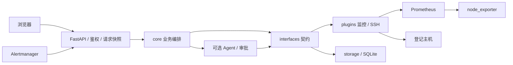
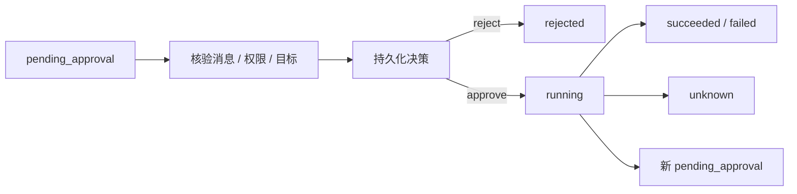

# 架构与实现详解

当前身份由独立受保护的 `/identity` 投影鉴权结果，前端以连接 epoch 丢弃旧请求。
审批 POST 仍同步执行，GET progress 只读已提交的决策和执行行，不调用 Agent 队列或外部服务，
因此可以在 SSH/AI 等待期间并发查询。前端依据持久事实推进阶段，原 POST 返回才确认 AI 反馈返回。
规则原子抢占中的 alert_key 由唯一关键字传入，存储层将它同步写入 action_executions，保持两行事务一致。
`HostOnboarding.remove` 复用 AdminConfigManager 的锁、revision、候选校验、备份和
RuntimeManager 应用屏障；在写盘前检查 ACL、规则、未完成执行，再按明确选择修改 hosts/file_sd。
外部 Prometheus 无写入口，删除不会调用会话/告警/审批/执行 Store 的删除方法。

schema 8 的 `approval_requests` 冻结新申请信息，人工决策与旧 `approval_decisions` 同事务
更新，执行状态仍来自 `action_executions`。`ApprovalHistory` 对旧决策/作废消息作只读投影，
API 先按当前角色和主机范围过滤再分页。历史表不承载 checkpoint，不改变重启后未决申请
不能续跑的约束；删除会话不删新冻结历史，常规 TTL/容量仍有效。
运行期过期/队列淘汰仅按该 Agent 的 host_id 对账；启动恢复才全局收敛，避免单台主机
的队列误作废其它主机的待审批项。

指标代码目录仍是唯一 PromQL 来源，`scripts.metric_contract` 从目录生成查询对照表和
Grafana 仪表盘；测试比较生成表达式并用隔离 promtool 求值。Grafana 独立鉴权，不能将
Assistant 的主机 ACL 当成 Grafana datasource 访问控制。

本文独立保留整体设计、调用链、状态机与设计依据，供接手和源码维护使用。描述当前实现，
不将规划视为能力。操作、完整字段分别维护在[部署与升级](deployment.md)、
[配置指南](configuration.md)和 [API 参考](api.md)。

## 运行形态与入口

项目面向少量 Linux 主机：FastAPI 提供 API 与同源控制台，Prometheus 提供指标和活动
告警，Alertmanager 投递通知，SQLite 保存历史，SSH 执行管理员登记的命令。LLM 可选，
无完整模型配置仍可查询指标、巡检和关键词问答。

当前一个 Assistant 进程、一个 worker。审批对象、LangGraph checkpoint、配置锁、
SSH 检查票据及调度线程含进程内状态，多 worker 或多个实例共享运行目录不受支持。
SQLite 持久化不能把这些状态自动变为分布式协调机制。

`scripts/deployment.py` 初始化派生运行文件，随后以单 worker 启动 `uvicorn src.main:app`。
`src/main.py:create_app` 读取配置、构造 Container、校验身份与 ACL、挂载路由和中间件，
在 lifespan 内维护唯一巡检调度器。导入 `src.main:app` 会创建应用；测试可注入独立配置。

## 分层与装配

依赖方向是 `api → core → interfaces ← plugins/storage`。API 负责输入、权限和 HTTP
契约；core 编排规则、会话、审批与巡检；interfaces 定义协议和数据结构；plugins 实现
监控、SSH、诊断及动作；storage 实现持久化。

`src/container.py` 是组合根，按需创建并缓存组件。Agent 重依赖在需要时加载，监控
主流程无需建立模型连接。固定指标目录位于 `src/metrics/catalog.py`，插件目录保留兼容
导出；除此类明确静态边界外，core 通过接口使用具体实现。

| 源码入口 | 责任 |
|---|---|
| `src/main.py`、`src/api/` | 生命周期、身份/主机权限、HTTP 契约 |
| `src/container.py` | 装配、热切换共享对象、存储降级 |
| `src/core/hosts.py`、`src/metrics/` | 主机状态、固定指标目录 |
| `src/core/agent.py`、`src/core/rule_engine.py` | webhook 编排、规则执行及归档 |
| `src/core/chat.py`、`src/api/approvals.py` | 会话轮次、审批授权和持久化边界 |
| `src/core/inspection.py`、`src/core/health.py` | 巡检调度、预算及健康语义 |
| `src/agent/`、`src/plugins/agent_actions/` | LLM 工具、LangGraph 中断与恢复 |
| `src/plugins/monitors/`、`src/plugins/common/` | Prometheus、SSH 与参数化命令 |
| `src/storage/` | SQLite schema、会话、历史、执行及幂等 |
| `src/utils/runtime.py`、`src/utils/admin_config.py` | 快照、revision、配置校验与切换 |
| `src/utils/admin_credentials.py`、`src/utils/host_onboarding.py` | 页面凭据、连接检查及登记 |
| `src/utils/config_migration.py`、`scripts/deployment.py` | 显式迁移与部署初始化 |
| `src/web/` | 原生控制台与安全 Markdown 展示 |

## 状态所有权

| 状态 | 所有者 | 生命周期与边界 |
|---|---|---|
| Settings、主机/指标目录、规则、命令目录、Agent | RuntimeSnapshot 与对应 Container | 切换创建新版本；已绑定读请求可用旧版本完成 |
| 数据库封装、会话/历史 Store、执行幂等、最近告警 | 切换时共享的组件 | 热切换不清空；跨重启能力取决于 Store |
| 待审批对象、LangGraph checkpoint | 进程内 Agent | 阻止配置切换；重启后不能续跑旧申请 |
| 调度线程和最近轮次 | 唯一 InspectionScheduler | 每轮读取当前快照；切换唤醒同一调度器 |
| YAML、凭据状态、managed 目标 | 本机磁盘 | revision 按内容计算；管理写锁仅限本进程 |
| SSH 检查票据 | 唯一 HostOnboarding | 5 分钟有效，绑定 revision 与目标；重启失效 |
| 身份、草稿和偏好 | console.js | Token 在标签页 sessionStorage；偏好在 localStorage；不是权限依据 |

数据库按操作打开短连接，并非共享一个长期 SQLite 连接。热切换保留 Store，避免重建
会话 Store 把活跃待审批误判为重启遗留；进程重启则必须执行保守对账。

## 配置来源与热更新

首次初始化复制 `deploy/templates/assistant/` 的七份模板；已有部署以运行 YAML 为准，
模板更新不会覆盖它们。init 从持久 compose.env 单向派生服务凭据。业务服务不自动
读取根 `.env`，根文件只作 Compose 输入及迁移检查对象。

读取器执行环境插值、类型与字段校验，再装配主机、指标和命令目录。页面模型配置整组
覆盖环境模型，清除页面密钥也不回退环境密钥。SSH 通过管理页显式登记，不再接受旧全局
SSH 环境目标。具体来源与优先级以配置指南为准。

RuntimeManager 用 ContextVar 固定一次 HTTP 请求的 RuntimeSnapshot。普通业务写请求
计入 active operation，读请求可继续用旧快照；管理员修改由管理器锁和 begin_apply 协调，
防止检查与提交之间插入新业务写操作。

1. 比较客户端 revision 与文件指纹，不一致返回 409。
2. 检查活跃写操作、未决审批及状态可验证性；不安全则返回 409。
3. 完整解析候选，校验目录引用、角色、ACL、凭据及目标关系。
4. 准备受限备份、写文件并构造新 Container，复用应保留的 Store 与调度器。
5. 提交新快照指针并唤醒调度器；普通异常按各管理器边界回滚。

revision 包括相关配置、页面凭据状态和 managed 目标内容，不含环境变量值。内存锁不能
阻止外部编辑器或第二进程写文件。页面保存的跨文件回滚不等同断电事务恢复，仍需完整
备份。数据库/日志路径等启动字段需重建，不能假定所有字段均可热应用。

## 身份、主机与权限

业务接口强制 Bearer Token，服务端映射身份，客户端用户名不能改变身份。管理 API
独立校验管理员。控制台空壳、指定静态资源、探针与 OpenAPI 文档公开，不含业务数据。
公网代理应限制不需要公开的文档路由。

主机注册表定义 host_id 到 job/instance、凭据引用与三类能力白名单。普通用户需要
host_access 授权；管理员可访问全部登记主机，但不能读取他人私有会话，也不自动成为
审批人。未知与越权主机/会话统一为 404。

会话绑定所有者和不可变 host_id。读取、聊天、改名、删除及审批重新验证当前访问权；
撤权不删除历史，恢复授权后仍可读。无 host_id 的记录查询也先过滤授权主机再合并、
排序和限量，避免未授权记录挤占结果。旧未知归属不猜测映射。

主机访问、监控、诊断及写能力分别校验。登记主机或 SSH 认证成功不自动授予写权限。
目标与连接材料由服务端解析，浏览器和模型不能提供自由 SSH 目标。

## 指标与告警查询

API 只接受固定 17 个 metric_id，不接受自由 PromQL。模板结合全局和指标 selector 后，
显式 MonitorTarget 强制绑定 job/instance。趋势接口保留的兼容 selector 参数不构成
任意运行时选择器入口。

趋势优先使用 range 表达式，否则以即时表达式调用 query_range。步长至少
max(15, ceil(时长秒数/240)) 秒，显式步长只能降低密度；最多 241 点、32 条序列。
序列按标签排序，各自保留采样点；缺失和非有限值以 null 表示断点。

摘要按阈值方向选最差设备：below 取最新值较小者，其余取较大者，避免跨磁盘/网卡
平均掩盖异常。无 Swap 为 not_applicable；ALERTS 只有在 up=1 时补零，采集失败不会
画成无告警。Exporter up=0、无数据、歧义和查询失败分别表达。

活动告警按精确 job/instance 过滤。webhook 归属必须有 instance；提供 job 时精确匹配，
没有 job 时仅在启用主机中 instance 唯一才归属。无法可靠归属时仍可记录，但不猜测 SSH
目标。告警 PromQL 应保留标签，见配置指南的编写约束。

## webhook 与规则自动处置

OpsAgent.process_alert 的真实顺序是：内存热缓冲 → 主机解析 → 匹配规则并执行 →
未匹配告警 AI 分析 → _archive 批量归档 → 返回。归档不是执行前置事务，远端动作与
SQLite 无法组成同一个原子事务。

resolved 不进入处置；启用的同名规则按顺序处理。已加载的匹配规则即使不自动执行，
也会阻止告警进入未匹配 AI；无可用执行器的规则可能未进入匹配目录。RuleEngine 含
实际 SSH I/O，并非纯决策器。

写执行同时要求全局自动处置、单规则、动作目录、主机白名单、SSH、唯一目标及执行
记录策略通过。规则写路径不经人工审批，因此总开关默认关闭。AI 失败记录后继续归档，
不增加权限或转换写路径。

告警、处置、建议在同一 SQLite 事务归档；失败返回 503 供 Alertmanager 重试。已完成
动作不会撤销；幂等记录保护重复写，AI 与告警历史不保证全局去重。内存最近告警重启
清空，长期历史使用 SQLite 查询。

## 会话与 Agent 工具调用

HTTP 聊天先创建服务端会话，不在 /chat 隐式认领任意 ID。仅一台获授权且启用主机时可
省略创建参数 host_id。名称只是标签，允许同名；NFKC 规范化、折叠空白、拒绝控制字符，
长度 1～64 个 Unicode 码点；改名不更新最后活动时间。

详情默认最近 100 条消息；模型上下文默认最近 20 条最终轮次消息，不是 token 预算。
审批核验覆盖全部持久 pending 消息，不受展示或模型窗口限制。

ChatService 优先使用绑定主机的 Agent，构造失败短暂冷却后重试，调用失败可回退关键词。
关键词“状态”当前返回固定“系统运行正常（模拟）”，不能作为健康证据；真实状态看指标、
Exporter 和探针。

工具来自受控指标、告警、巡检及获授权诊断/动作。每轮新建 LangGraph thread_id，
会话历史由业务层显式传入，checkpoint 不替代 SQLite。仅启用写工具时装配内存
checkpointer 与 Human-in-the-loop；完成/失败删除线程，待审批时保留供恢复。

普通最终回答保存历史失败仍可能返回回答；pending 保存失败取消申请并返回 503。
会话在回答期间删除则 404，不重建。存储关闭或无法验证会话时 HTTP 聊天 503，内部
无存储调用能力不构成匿名 HTTP 入口。

## 人工审批与执行状态机

申请冻结主机、动作、参数、配置指纹和申请人。决策仅 approve/reject，不编辑命令。
owner 模式按申请人授权，approvers_only 按审批角色授权；同时验证申请人与审批人当前
主机访问权，管理员不绕过这些条件。

内存 ApprovalStore 加锁原子消费，保证同一进程一次处理。过期/淘汰返回移除对象，调用方
释放 checkpoint 并收敛消息。批准先核验持久 pending 消息，再消费对象、持久记录决策、
恢复原线程。

决策落库失败在恢复之前，可重新入队并重试同一 ID；决策提交后续跑异常不能重新入队，
因为动作可能已发生。链式下一条申请保存失败则取消下一条，原 ID 不恢复。503 必须
区分这些阶段，先看执行记录再决定重试。

审批决策回答“谁决定”，action_executions 回答“动作执行到何阶段”，幂等记录回答
“是否已抢占”。SSH 尝试派发后断线/超时为 unknown，不自动重试；最终状态保存失败
也可能留下 running，需要核对远端。
服务端没有返回退出状态时，Paramiko 的 `-1` 同样归为 unknown，不作为普通失败码。
真实退出码 0 才记录 succeeded；非零记录 failed，但不能据此认定目标没有发生改变。
Agent 工具对未知结果使用独立异常和文案，避免在送给模型时被改称“执行失败”。

重启时无决策的 pending 收敛为 abandoned，有决策但不能确认结果收敛为 unknown，
不自动补执行。链式前序动作可能已完成，abandoned 不代表整段会话从未写入。幂等有 TTL，
恢复旧备份可能丢失较新的键，不承诺无限期或跨所有故障的 exactly-once。

## SSH 与命令安全

连接加载系统和显式 known_hosts，用 RejectPolicy 拒绝未知密钥。连接检查只认证，
不执行命令或授予权限。凭据通过服务端引用解析，普通 API 不能指定任意文件路径。

模板属于可信管理员配置。字符串先 re.fullmatch 再 shlex.quote，整数转换后按上下界收敛；sudo
通过受控 shell 执行。公共 SSH 执行函数不识别业务白名单，调用方先验证目录、能力及
审批。诊断只读也依赖管理员提供真正只读模板。
sudo 用 `sh -c` 启动固定加载器，将已授权脚本原文送入 SSH stdin 并关闭写方向。
加载器先完整读取并检查读取状态，再清理内部变量、在同一 POSIX sh 中解析脚本；业务命令
不会抢读尚未解析的模板。直接 `sh -s` 的长模板存在这种 stdin 竞争，不能作为最终实现。
固定加载器的 eval 仅解析经过目录/参数授权的完整脚本，与原 sh -c 的模板解析边界一致，
不接受模型自由命令。继续排空 stdout/stderr 并读取退出状态。
旧 `sudo sh -c <脚本>` 会把模板放进包装进程 argv，使 `pkill -f` 连同 sudo/shell 一起
匹配并终止，造成目标已改变但执行通道异常。非 sudo 路径保持原执行方式；无匹配等真实
非零状态不被转换为成功。退出码只能证明进程如何结束，不能证明所有业务后置条件。

超时分别作用于 TCP、banner、认证、通道及输出，不是业务总时限。stdout/stderr 共用
原始读取字节预算，解码后各自按字符上限截断，并非合计字符上限。一旦尝试派发，
传输异常不能证明远端没执行。

脱敏覆盖注册值、敏感键、常见文本模式及私钥块，应用于 API、日志及模型上下文；
不保证识别任意秘密，不追溯重写旧日志/数据库。仍需文件权限与受控备份。

## 巡检、健康与存储降级

唯一 daemon 调度线程每轮取当前 checker。关闭 inspection 时线程等待，不执行巡检；
配置切换唤醒并重读间隔，不保证保存后立即一轮。多主机按游标轮转，查询预算按选中指标
加一次 Exporter 检查估计，至少允许一台；时间预算在主机边界检查，不是硬截止时间。

每轮写日志，非 normal 才归档，归档失败记录后继续调度。最近轮次是缓存，不能将最后
成功视为远端当前健康。

/health 无外部 I/O，HTTP 200 仍可含 degraded；/ready 主动探测 Prometheus，并结合
启用的存储和巡检状态决定 200/503。单 Exporter 不可达不等于全局未就绪，LLM/SSH
不是全局就绪前置条件。

存储启用但数据库装配失败时，会话退化到内存，历史/巡检/执行 Store 不可用，健康降级。
内存会话仍校验身份与主机，重启丢失。装配失败会被缓存，修复后可能需重启；没有
持久执行 Store 时规则/Agent 写能力受限。

## SQLite 与保留策略

每操作打开关闭连接，显式事务、busy timeout 和有限重试；优先 WAL，不支持时退回
DELETE，不通过 check_same_thread=False 共用连接。父子一致性依赖显式事务，不假定
外键自动级联。

PRAGMA user_version 当前为 8。已有迁移含索引调整，不能概括为“只加列”；新迁移
追加版本分支。v7 逐列检查支持重试，旧 host_id 保持未知，不猜测归属；v8 新增独立
申请历史表与索引，不重建旧 checkpoint。新版本数据库不交给旧版程序写入。

会话、告警/处置/建议、决策、幂等、执行及巡检分别保存，各有 TTL 与容量；清理由相关
操作触发，空闲时不保证到期即删。pending 引用决策有保护。默认阈值以配置指南和模板
为准；SQLite 恢复不等于 YAML、凭据与监控卷恢复，详见[数据库说明](database.md)。

## 部署初始化与迁移事务

Compose 一次性 init 与五个常驻服务；配置/数据/日志为绑定挂载，Prometheus、
Alertmanager、Grafana 用命名卷，各服务只挂载所需派生凭据。端口默认 127.0.0.1。
local-node 代表容器环境，真实宿主机需独立 Exporter 和显式登记，不自动安装远端程序。

已完成部署缺源凭据或任一 YAML 拒绝启动，避免重置身份/配置；派生文件可从保留来源
再生成。初始化检查点避免中断重置 Token，POSIX init 用文件锁，普通管理仍为进程锁。

旧字段必须停栈后 migrate-config。先完整校验候选，保存 before/after、哈希和 manifest，
登记 pending，逐文件原子替换后完成。普通异常恢复原稿；中断后下次迁移恢复，哈希
不匹配拒绝覆盖人工改动。正常启动拒绝 pending，不能删标记绕过。此事务机制只属于
显式迁移，不应套用到所有页面保存。

## 页面凭据与模型生命周期

admin-credentials 存状态及版本 SSH 资产，不在普通 YAML 备份内。旧请求可引用旧资产，
没有自动垃圾回收。POSIX 页面凭据目录/文件权限受限；服务派生目录另有非 root 容器读取
安排，不能宣称所有文件 0600。凭据本地明文存储，备份加密由部署方负责。

保存模型校验配置，不联网；显式测试短超时、零重试、小输出，业务聊天/告警 AI 也发真实
请求。模型按配置指纹缓存，最多 16 版本，清除密钥不复用旧对象。SDK 超时/重试按单请求
生效，多工具回合可多次请求，不是整轮总时限。仅支持 Chat Completions 和标准工具调用。

## 控制台实现

原生 HTML/CSS/JavaScript，无前端构建框架。异步结果核对当前身份、主机、会话与时间
范围，避免旧请求覆盖新状态。配置草稿整份保存，凭据用专用 API；新 Token 当次展示，
离开操作清除。

Markdown 用本地 Marked 分词，再以 createElement/textContent 和允许列表建 DOM。
HTML 当文本，图片仅显示说明不下载，链接仅允许无嵌入凭据的绝对 HTTP(S)。超出长度、
节点/嵌套预算或加载失败降级纯文本，不支持 Mermaid、公式和语法高亮。展示不扩大权限。

## 设计依据与扩展边界

- 单 worker 使配置、审批与调度的协调可验证；多实例需先替换这些状态及锁。
- 显式主机和分开的访问/能力授权，避免模型、监控标签或 SSH 认证自动变成写权限。
- 规则与人工审批两条写路径分别用于确定规则和人工判断，默认不开放自动处置。
- 远端与本地无法原子提交，持久决策、幂等和 unknown 保留证据，避免盲目重放。
- 请求快照避免混用规则，热切换共享 Store，重启按 checkpoint 丢失的事实对账。
- SQLite 和原生控制台降低小规模成本；没有高可用、分布式执行或流式模型输出承诺。

插件遵循 interfaces 并在 Container 装配；新增指标同步表达式、单位、阈值方向、页面
及真实引擎求值；写动作覆盖授权、审批/规则边界、幂等和未知结果。开发门禁见
[贡献约定](../CONTRIBUTING.md)，完整测试流程见[容器测试与验收](testing.md)。

## 待核实与现场约束

真实模型工具兼容性、SSH 权限/密钥、Exporter 采集范围逐部署验收。恢复时间与数据丢失
目标、满盘/断电、长期容量、并发上限、生产浏览器和代理 TLS 需在目标环境演练；源码与
离线测试不能替代证据。关键词模拟“状态”、审批跨重启失效及有限期幂等是当前限制。
